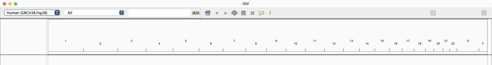

# igv-l10n · IGV 多语言汉化工具链

给 **IGV Desktop**（Integrative Genomics Viewer）做界面汉化/多语言的开源工具链。
不是"再 fork 一个 IGV"，而是：**一个 java agent + 一张词表 + 一套给译者用的工具**。

- 不动 IGV 安装包，不破坏代码签名，不需要 sudo
- 一条命令安装，删一行就关掉
- 词表是纯文本 TSV，改一行即时生效，适合协作翻译
- 内置**字节码级安全审计**，自动避开会改坏 session 文件 / 偏好设置的字符串
- 已经支持任意语言（`locales/<lang>/strings.tsv`），简体中文是第一个语言包




```
$ bin/igv-l10n setup zh_CN
IGV:     /Applications/IGV_2.19.1.app/Contents/Java/lib/igv.jar
版本:    2.19.1
语言:    zh_CN
== 审计（生成禁译规则）     禁译规则 1031 条
== 演练                     命中 110 个类 / 456 处字符串，结构校验通过
已安装到 ~/.igv/l10n，重启 IGV 生效
```

## 效果

| 原文 | 汉化后 |
|---|---|
| File / Genomes / View / Tracks / Regions / Tools / Help | 文件 / 基因组 / 视图 / 轨道 / 区域 / 工具 / 帮助 |
| Load Genome from File... | 从文件载入基因组... |
| Fit Data to Window | 数据适应窗口 |
| Group alignments by | 按…分组比对 |
| Sort By Depth | 按深度排序 |
| Save PNG Screenshot ... | 保存 PNG 截图... |

当前 zh_CN：**360 条词条，覆盖 110 个类、456 处界面字符串**；菜单栏 72%、比对右键菜单 58%、
文件/视图动作 52%、通用控件 46%、数据面板 40%。

## 快速开始

要求：macOS / Linux / Windows，已安装 IGV（任何 2.x 版本），有 JRE 17+（IGV 自带即可）。

```bash
git clone https://github.com/<you>/igv-l10n.git
cd igv-l10n
bin/igv-l10n setup zh_CN      # 构建 + 审计 + 演练 + 安装
```

然后**退出并重启 IGV**。验证：

```bash
bin/igv-l10n status
# 加载行:   已启用
# 最近日志: 01:57:42 [igv-l10n] org/broad/igv/ui/IGVMenuBar : 64 处
```

卸载：`bin/igv-l10n uninstall`（只删加载行，文件保留）。

## 它是怎么工作的

IGV 桌面版**没有 i18n 框架**：整个 `igv.jar` 里只有 2 个 `.properties`，源码里 `ResourceBundle` 出现 0 次，
界面文字全是硬编码的 Java 字符串常量（实测 1589 个 class、5219 条字面量）。

所以汉化只能"改程序"。igv-l10n 在**类加载时**改写 class 文件常量池：

```
igv.jar 里的 class
      │  ClassFileTransformer（java agent）
      ▼
CONSTANT_String "File" ──► 追加 CONSTANT_Utf8 "文件"，String 项改指向它
      │                    （原 Utf8 保留：它可能同时是字段名）
      ▼
JVM 看到的中文界面
```

三条纪律保证不把 class 改坏：

1. 只动 `CONSTANT_String`，不动 `CONSTANT_Utf8`；
2. 译文作为新项追加，原项不动；
3. class 内部引用全是常量池下标、没有绝对文件偏移，常量池变长不影响方法体/StackMapTable。

离线演练会对每个改写后的 class 做一次 ASM 完整解析（`parsed ok / bad`），CI 里同样会跑。

## 最难的部分：同一段英文的两个身份

`"Regions"` 既是菜单名（该翻成"区域"），又是 session XML 的标签名（翻了旧会话就打不开）。
`javac` 会把 `static final String` 内联到使用处，所以它在 class 里就是普通字面量，靠"只翻 ui 包"躲不掉。

`bin/igv-l10n audit` 用 ASM 做数据流分析，把每个字符串字面量分成三类：

| 类别 | 例子 | 处理 |
|---|---|---|
| **STRUCT** 写文件 / 读属性 / 反射 / 正则 | `document.createElement("Regions")`、`prefs.get("IGV.Bounds")` | 按类禁译 |
| **COMPARE** 参与判断 | `nodeName.equals("Regions")`、`map.get("chr1")` | 结构用途字面量 → 一起禁译；否则进人工复核清单 |
| **DISPLAY** 纯展示 | `new JMenuItem("File")`、`label.setText(...)` | 放心翻译 |

结果写在 `igv/<version>/deny_by_class.tsv`，agent 加载词表时一并读取：

```
org/broad/igv/session/SessionWriter      Regions
org/broad/igv/session/IGVSessionReader   Regions
org/broad/igv/ui/IGVMenuBar              (无规则 -> 正常翻译)
```

细则见 [docs/safety-rules.md](docs/safety-rules.md)。

## 给别人加语言

```bash
bin/igv-l10n new ja_JP        # 从本机 igv.jar 生成 2393 行骨架，按区域分好组
# 编辑 locales/ja_JP/strings.tsv
bin/igv-l10n check            # 校验占位符、重复键、失效词条
bin/igv-l10n coverage ja_JP   # 看覆盖率
bin/igv-l10n setup ja_JP      # 安装试用
```

词表格式（TSV，Excel/Numbers 可直接编辑）：

```tsv
File	ファイル
Load Genome from File...	ファイルからゲノムを読み込む...
```

- 第 3 列可选，写备注，不参与匹配
- 含 `%s` / `%d` / `\u0001` 的条目必须保留同样数量的占位符，否则 `check` 直接失败
- 术语一致性用 `locales/<lang>/glossary.tsv` 约束

详见 [docs/adding-a-language.md](docs/adding-a-language.md)。

## 命令一览

| 命令 | 作用 |
|---|---|
| `bin/igv-l10n setup [locale]` | 构建 + 审计 + 演练 + 安装（默认 zh_CN） |
| `bin/igv-l10n install/uninstall` | 只安装 / 只移除加载行 |
| `bin/igv-l10n status` | 安装状态 + 最近日志 |
| `bin/igv-l10n new <locale>` | 生成词表骨架 |
| `bin/igv-l10n check` | 校验全部词表（CI 同款） |
| `bin/igv-l10n coverage <locale>` | 覆盖率报告 |
| `bin/igv-l10n dryrun <locale>` | 离线演练，不启动 IGV |
| `bin/igv-l10n audit` | 对当前 igv.jar 重新生成禁译规则 |
| `bin/igv-l10n extract` | 导出候选字符串 |
| `bin/igv-l10n package <locale>` | 打发布 zip（含独立 installer） |
| `bin/igv-l10n test` | 构建 + 校验 + 演练 |
| `bin/igv-l10n build` | 只构建 |

环境变量：`JAVA`、`IGV_JAR`、`IGV_VERSION`、`IGV_L10N_HOME`、`IGV_JAVA_ARGS`。

## 安装原理（为什么不用改 app）

IGV 的 macOS 启动器每次都会把 `~/.igv/java_arguments` 当 JVM 参数文件传给 java：

```bash
ps aux | grep igv
# java ... @Java/igv.args ... @/Users/you/.igv/java_arguments --module=org.igv/...
```

这是官方留的用户级 JVM 参数入口。我们只往里加一行：

```
-javaagent:~/.igv/l10n/igv-l10n-agent.jar=~/.igv/l10n
```

因此：不改 `/Applications`，不破坏签名，升级 IGV 不被覆盖，删掉这行就完全恢复。
Windows/Linux 同理（`%USERPROFILE%\.igv\java_arguments` / `~/.igv/java_arguments`）。

## 目录结构

```
igv-l10n/
├── bin/igv-l10n                 # 统一入口
├── src/agent/java/org/igvl10n/  # 运行时 agent（零依赖）
│   ├── Agent.java               # premain、语言选择、日志
│   ├── ClassPatcher.java        # 常量池改写
│   └── StringsTable.java        # 词表 + 禁译规则 + 占位符校验
├── src/tools/java/.../tools/    # 构建期工具（ASM）
│   ├── Audit.java               # 字节码安全审计
│   ├── Extract.java             # 候选导出 / 词表骨架
│   ├── Check.java               # 词表校验
│   ├── Coverage.java            # 覆盖率
│   └── DryRun.java              # 离线演练 + 结构校验
├── locales/zh_CN/               # 词表、术语表、元信息
├── igv/2.19.1/                  # 每个 IGV 版本一份禁译规则（自动生成）
├── docs/                        # 原理、加语言、安全规则
└── scripts/                     # build / package-install
```

## 常见问题

**为什么不直接 fork IGV 改源码？**
可以，而且更"正统"，但那样每跟一个 IGV 版本就要重做一次合并。现在的做法把"翻译"和"IGV 代码"解耦：词表按字面量匹配，IGV 升级后重跑 `audit` 即可，通常不用改 agent。

**会不会把 session 文件改坏？**
不会。这正是 `audit` 和 `deny_by_class.tsv` 存在的意义；`check` 和 CI 都会守住这条线。

**IGV 升级后还能用吗？**
能。先 `bin/igv-l10n audit` 重新生成规则，再 `bin/igv-l10n check` 看哪些词条失效，然后 `setup`。

**为什么有的地方还是英文？**
两种原因：一是词表还没翻（看 `coverage`）；二是那条字符串被判定为结构 key（看 `igv/<version>/deny_by_class.tsv`），翻了会出问题。

**Windows 上能用吗？**
agent 是纯 Java，跨平台。`bin/igv-l10n` 是 bash 脚本，Windows 需用 Git Bash 或 WSL 运行；
也可以直接用发布包里的 `install.sh`（同样需要 bash），或手工把 `igv-l10n-agent.jar`、
`locales/`、`deny_by_class.tsv` 放到 `%USERPROFILE%\.igv\l10n\`，再往
`%USERPROFILE%\.igv\java_arguments` 加同一行 `-javaagent`。

**为什么不用 ResourceBundle？**
IGV 没有。加 i18n 需要改 2333 处调用点，那是另一个量级的项目；这条路线可以作为上游 PR 慢慢推进。

## 验证记录

| 验证 | 结果 |
|---|---|
| 真机启动 IGV 2.19.1（`@~/.igv/java_arguments` 生产路径） | 菜单栏：文件 / 基因组 / 视图 / 轨道 / 区域 / 工具 / 帮助 |
| 离线全量演练 | 110 个类、456 处替换，`结构校验通过` |
| ASM 结构校验 | 每个改写后的 class 都能完整解析 |
| 假 igv.jar 自检（`tests/run.sh`） | `File` 被翻译、`Regions` 保持原文 |
| 审计可复现 | 两次 `audit` 输出逐字节相同 |
| 安装 / 卸载 / 重装 | 沙箱 HOME 下全部通过，重复安装不产生重复行 |

## 参与

见 [CONTRIBUTING.md](CONTRIBUTING.md)。翻译不需要懂 Java：改 TSV、跑 `check`、提 PR 即可。

## License

MIT。IGV 本身归 Broad Institute，本项目只分发"差异"（agent + 词表），不包含 IGV 的任何二进制。
